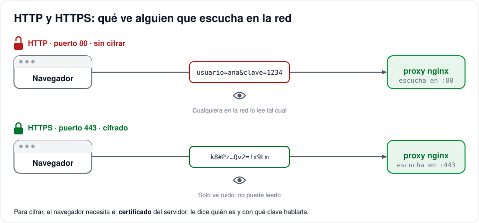
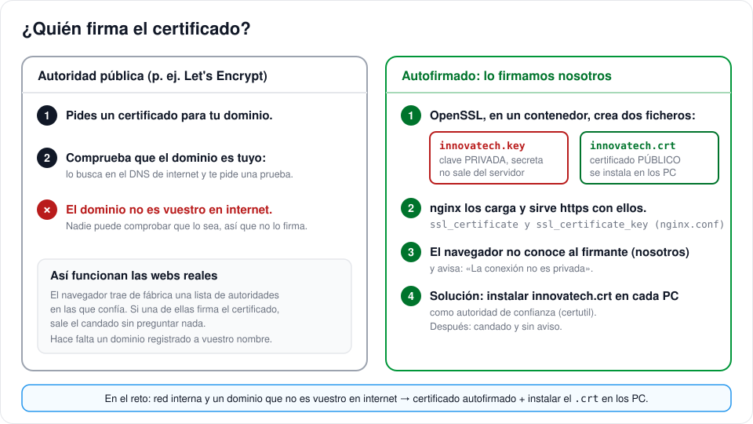
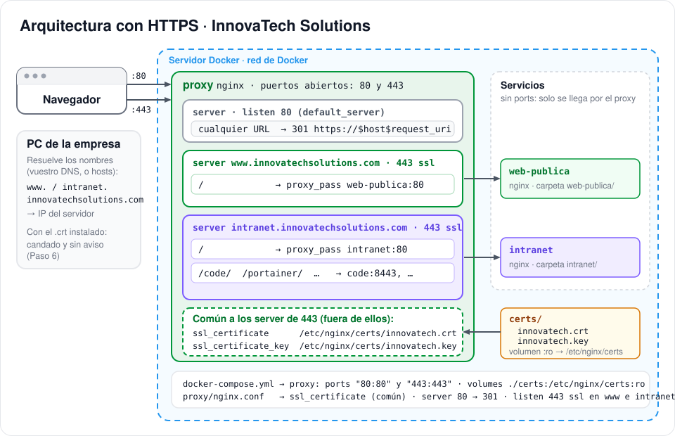
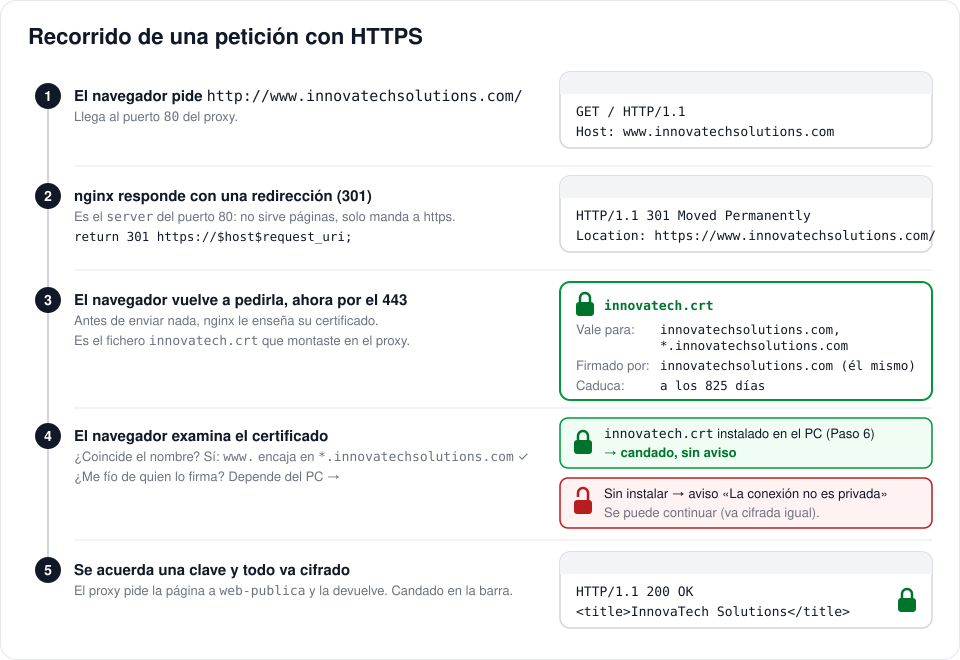

# 🔒 HTTPS en el reto: cómo añadir los certificados

En el reto, la web y la intranet de InnovaTech Solutions se sirven por **HTTP**: lo que viaja entre el navegador y el servidor va en texto plano, y cualquiera conectado a la misma red puede leerlo. En esta guía vas a pasar el proxy a **HTTPS** con un certificado que firmaréis vosotros mismos, y a dejar el puerto 80 solo para redirigir. Al terminar, `https://www.innovatechsolutions.com` y `https://intranet.innovatechsolutions.com` abrirán con candado en los PC de la empresa.

La guía sigue la arquitectura de [Hacia el reto](../readme.md#-hacia-el-reto-la-arquitectura-final): un `nginx.conf` con un `server` para `www` y otro para `intranet`, que reenvían a los contenedores `web-publica` e `intranet`. Si vuestro dominio o vuestros nombres de servicio son otros, cámbialos en todos los sitios donde aparezcan.

## Índice

- [🎯 Qué vas a hacer](#-qué-vas-a-hacer)
- [🧠 Conceptos](#-conceptos)
- [🧰 Pasos](#-pasos)
- [🔄 Cómo aplicar los cambios](#-cómo-aplicar-los-cambios)
- [🩺 Problemas frecuentes](#-problemas-frecuentes)
- [📤 Entrega](#-entrega)

---

## 🎯 Qué vas a hacer

1. Generar un certificado autofirmado con OpenSSL, dentro de un contenedor, sin instalar nada en el servidor.
2. Montarlo en el proxy y abrir el puerto 443.
3. Pasar los `server` de nginx a `443 ssl` y añadir uno nuevo en el 80 que redirija a https.
4. Comprobar el recorrido completo e instalar el certificado en los PC para que el navegador no avise.

Tocarás cuatro ficheros. Ninguno es largo:

| Fichero | Qué cambia |
|---|---|
| `certs/innovatech.crt` y `certs/innovatech.key` | Nuevos: el certificado y su clave privada (Paso 1) |
| `.gitignore` | Añade `certs/` para no subir la clave a GitHub (Paso 2) |
| `docker-compose.yml` | Publica el 443 y monta `certs/` en el proxy (Paso 3) |
| `proxy/nginx.conf` | Carga el certificado, redirige el 80 y pasa los `server` a `443 ssl` (Paso 4) |

---

## 🧠 Conceptos

### ¿Qué cambia con HTTPS?



Con HTTP, lo que escribes en un formulario viaja tal cual: un usuario y una contraseña se leen a simple vista con cualquier programa que escuche en la red (en el aula, en una wifi pública, en la red de la empresa). Con HTTPS el navegador y el servidor acuerdan una clave y cifran todo lo que se envían; quien escuche solo ve ruido.

Para poder cifrar, el navegador necesita saber **con quién habla**. Eso es el **certificado**: un fichero que el servidor le enseña al navegador y que dice «soy `www.innovatechsolutions.com`, esta es mi clave pública y esto lo firma tal entidad». El navegador comprueba dos cosas: que el nombre del certificado coincide con la URL que ha pedido, y que quien lo firma es alguien de confianza.

### ¿Quién firma el certificado?



Las webs reales usan certificados firmados por una **autoridad de certificación** (Let's Encrypt, por ejemplo, que es gratuita). Antes de firmar, la autoridad comprueba que el dominio es tuyo buscándolo en el DNS de internet. El dominio de vuestra empresa solo existe en vuestro DNS, dentro de la red: ninguna autoridad pública puede comprobar que sea vuestro, así que no lo firmará.

La alternativa es un certificado **autofirmado**: lo creáis y lo firmáis vosotros con OpenSSL. Funciona exactamente igual para cifrar, con una pega: el navegador no conoce al firmante, así que avisa con «La conexión no es privada». Se arregla instalando el certificado en cada PC de la empresa como autoridad de confianza (Paso 6).

OpenSSL genera **dos ficheros**, y es importante no confundirlos:

| Fichero | Qué es | Quién lo tiene |
|---|---|---|
| `innovatech.key` | La **clave privada**. Con ella el servidor descifra lo que le mandan | Solo el servidor. Nunca se copia, nunca se sube a git |
| `innovatech.crt` | El **certificado**, con la clave pública y los nombres para los que vale | Es público: nginx lo enseña a todo el mundo y se instala en los PC |

### Cómo encaja en el proxy



El proxy pasa a tener **dos puertos abiertos**, 80 y 443, y un `server` más:

- El del **puerto 80** no sirve ninguna página: responde a cualquier URL con un `301` que manda al navegador a la misma dirección con `https://`. Así los enlaces y marcadores antiguos siguen funcionando.
- Los de **www** e **intranet** (y el de Duplicati, si lo tienes) son los que ya tenías, cambiando `listen 80` por `listen 443 ssl`.

El certificado se declara **una sola vez**, fuera de los `server`, junto a las cabeceras `proxy_set_header` que ya están ahí. Igual que ellas, lo heredan todos los bloques. Los ficheros llegan al contenedor por un volumen: la carpeta `certs/` del repo se monta en `/etc/nginx/certs`.

**El cifrado termina en el proxy.** Los contenedores `web-publica`, `intranet`, `code`… siguen hablando HTTP normal con el proxy por la red interna de Docker, que nadie de fuera ve. Solo el proxy necesita el certificado. La cabecera `X-Forwarded-Proto`, que ya mandas a todos los servicios, pasa a valer `https`: así un servicio sabe que el usuario entró cifrado aunque a él le llegue por http.

### ¿Y vuestro DNS?

El certificado va ligado a los **nombres** (`www.innovatechsolutions.com`, `intranet.innovatechsolutions.com`), no a la IP ni a cómo se resuelven. Lo que importa es que los nombres de vuestro DNS y los del certificado (`-addext` del Paso 1) sean **los mismos**.

Con vuestro servidor **DNS y DHCP**, lo que hay que tener:

- En el DNS, un registro `A` para `www`, otro para `intranet` (y `duplicati`, si lo usas) y otro para el dominio solo, todos con la IP del servidor Docker.
- En el DHCP, que reparta ese DNS a los PC (opción 6, «servidores DNS»). Así ningún PC necesita tocar `hosts`.
- Que el servidor Docker tenga **IP fija** o una reserva en el DHCP. Si cambia de IP, los registros `A` dejan de apuntar a él y nada funciona, con o sin HTTPS.

El DNS no sustituye al Paso 6: resolver el nombre y fiarse del certificado son cosas distintas, y el `.crt` hay que instalarlo en cada PC igualmente.

---

## 🧰 Pasos

### Paso 0 · Antes de empezar

Necesitas el repositorio del reto clonado en el servidor, Docker en marcha, el `.env` creado y la pila funcionando **por HTTP**: `docker compose up -d` y `http://www.innovatechsolutions.com` abre desde un PC que use vuestro DNS. Si todavía estás probando en tu PC con los nombres `.localhost` (`http://www.innovatechsolutions.com.localhost`), también vale: el certificado del Paso 1 incluye esos nombres.

Todos los comandos van en la terminal del servidor, desde la carpeta del repositorio. Están escritos para **PowerShell**; en Linux son los mismos cambiando `${PWD}` por `$PWD`.

### Paso 1 · Genera el certificado

No hace falta instalar OpenSSL: se usa un contenedor que lo trae, se le pasa la carpeta `certs/` como volumen y, al terminar, desaparece.

**1. Crea la carpeta** `certs/` en la raíz del repo:

```powershell
mkdir certs
```

**2. Lanza OpenSSL** en un contenedor. Es un solo comando, aunque sea largo. Cópialo entero:

```powershell
docker run --rm -v "${PWD}/certs:/certs" alpine/openssl req -x509 -newkey rsa:2048 -nodes -days 825 -keyout /certs/innovatech.key -out /certs/innovatech.crt -subj "/CN=innovatechsolutions.com" -addext "subjectAltName=DNS:innovatechsolutions.com,DNS:*.innovatechsolutions.com,DNS:*.innovatechsolutions.com.localhost,DNS:localhost"
```

Verás unas líneas de puntos y símbolos `+` mientras genera la clave. Esto es lo que hace cada trozo:

| Trozo | Qué hace |
|---|---|
| `docker run --rm` | Arranca un contenedor y lo borra al terminar |
| `-v "${PWD}/certs:/certs"` | La carpeta `certs/` del repo se ve dentro del contenedor como `/certs`. `${PWD}` es la carpeta actual |
| `alpine/openssl` | La imagen: Alpine con OpenSSL instalado |
| `req -x509` | Crea un certificado **autofirmado** (en vez de una solicitud para una autoridad) |
| `-newkey rsa:2048 -nodes` | Genera una clave nueva de 2048 bits y la guarda **sin contraseña**, para que nginx pueda arrancar solo |
| `-days 825` | Caduca a los 825 días (unos 27 meses) |
| `-keyout … -out …` | Dónde guarda la clave privada y el certificado |
| `-subj "/CN=innovatechsolutions.com"` | El nombre principal del certificado |
| `-addext "subjectAltName=…"` | Los **nombres para los que vale**. El `*` cubre **un solo nivel**: `www.innovatechsolutions.com` e `intranet.innovatechsolutions.com` sí; `www.intranet.innovatechsolutions.com` no. Si usas un nombre con dos niveles, añádelo entero a la lista |

> Si vuestro dominio es otro, cámbialo en `-subj` y en `-addext`, y pon vuestro nombre a los dos ficheros. Acuérdate de usar los mismos nombres de fichero en el Paso 4.

**3. Mira qué ha creado:**

```powershell
ls certs
```

Tienen que estar `innovatech.crt` e `innovatech.key`.

✅ **Comprueba** el contenido del certificado con el mismo contenedor:

```powershell
docker run --rm -v "${PWD}/certs:/certs" alpine/openssl x509 -in /certs/innovatech.crt -noout -subject -dates -ext subjectAltName
```

Debe salir `subject=CN=innovatechsolutions.com`, las fechas y una lista `DNS:innovatechsolutions.com, DNS:*.innovatechsolutions.com, …`. Si falta algún nombre, repite el paso 2.

### Paso 2 · Que la clave no acabe en GitHub: `.gitignore`

La clave privada es secreta. Si la subes al repositorio, cualquiera que lo vea puede hacerse pasar por vuestro servidor. Añade la carpeta entera al `.gitignore`, junto al `.env`:

```diff
 # Claves: viven en tu PC, NUNCA en git
 .env
+certs/
```

Cada equipo que clone el repo tendrá que generar su certificado con el Paso 1. Es lo normal: el certificado se crea en el servidor y no se mueve de ahí (salvo el `.crt`, que se copia a los PC en el Paso 6).

✅ **Comprueba** con `git status` que no aparece nada de `certs/`.

### Paso 3 · `docker-compose.yml`: puerto 443 y carpeta `certs/`

Son dos líneas nuevas en el servicio `proxy`. Una en `ports`, debajo de la del 80, y otra en `volumes`, debajo de la del `nginx.conf`. Respeta la sangría de las líneas vecinas:

```diff
   proxy:                        # reverse proxy: la única puerta de entrada
     image: nginx:alpine
     restart: unless-stopped
     ports:
       - "80:80"                 # http: solo redirige a https
+      - "443:443"               # https. ¿Puerto ocupado? Usa otro: "8443:443"
     volumes:
       - ./proxy/nginx.conf:/etc/nginx/conf.d/default.conf:ro   # la configuración
+      - ./certs:/etc/nginx/certs:ro                            # el certificado (Paso 1)
```

`:ro` significa *read only*: nginx puede leer el certificado pero no cambiarlo. Como has tocado el compose, hay que recrear el contenedor:

```powershell
docker compose up -d
```

✅ **Comprueba** con `docker compose ps` que el proxy está `Up` y que en la columna de puertos aparecen los dos: `0.0.0.0:80->80/tcp` y `0.0.0.0:443->443/tcp`. Todavía no responde por https (nginx no sabe nada del certificado); eso viene ahora.

### Paso 4 · `proxy/nginx.conf`: certificado, redirección y `443 ssl`

Son tres cambios en el mismo fichero. Hazlos en orden y reinicia el proxy al final.

**4a. Declara el certificado.** Va en la parte de arriba, fuera de cualquier `server`, justo después de las cabeceras comunes (la línea `client_max_body_size 50m;`) y antes del primer `server`. Así lo heredan todos los `server` que van a escuchar en 443:

```diff
 proxy_set_header Connection $connection_upgrade;
 client_max_body_size 50m;           # tamaño máximo de lo que se sube (formularios, ficheros)

+# HTTPS: un solo certificado para todos los nombres (innovatechsolutions.com y *.innovatechsolutions.com).
+# Se genera con el comando de docs/https.md y queda en ./certs, montado en /etc/nginx/certs (docker-compose.yml).
+# Está aquí fuera para que lo hereden todos los bloques server que escuchan en 443.
+ssl_certificate     /etc/nginx/certs/innovatech.crt;
+ssl_certificate_key /etc/nginx/certs/innovatech.key;
+ssl_protocols       TLSv1.2 TLSv1.3;
+
 # =====================================================================================
 # WEB PÚBLICA: www.innovatechsolutions.com
```

Las rutas son las **de dentro del contenedor** (`/etc/nginx/certs/…`), no las de tu carpeta. `ssl_protocols` deja fuera las versiones antiguas e inseguras de TLS.

**4b. Añade el `server` que redirige.** Va justo antes del comentario `# ===== WEB PÚBLICA`. Escucha en el 80 para cualquier nombre (`server_name _` es el comodín) y responde con una redirección permanente a la misma URL por https:

```nginx
# =====================================================================================
# HTTP → HTTPS: todo lo que llegue por el puerto 80, sea el nombre que sea, se redirige a https.
# (Si publicas el 443 en otro puerto, añádelo: https://$host:8443$request_uri)
# =====================================================================================
server {
    listen 80 default_server;
    server_name _;
    return 301 https://$host$request_uri;
}
```

`$host` es el nombre que pidió el navegador y `$request_uri` la ruta con sus parámetros, así que `http://intranet.innovatechsolutions.com/code/?x=1` acaba en `https://intranet.innovatechsolutions.com/code/?x=1`.

**4c. Pasa los `server` a 443.** En el de la web pública, `listen 80 default_server;` pasa a `listen 443 ssl default_server;`. En el de la intranet, `listen 80;` pasa a `listen 443 ssl;`. Si tienes más (Duplicati), igual. Nada más cambia:

```diff
 server {
-    listen 80 default_server;       # default_server: recoge los nombres que no encajan en otro server
+    listen 443 ssl default_server;  # default_server: recoge los nombres que no encajan en otro server
     server_name www.innovatechsolutions.com;
 ...
 server {
-    listen 80;                    # sin default_server: solo puede haber uno por puerto
+    listen 443 ssl;               # sin default_server: solo puede haber uno por puerto
     server_name intranet.innovatechsolutions.com;
```

Fíjate en que ahora hay **dos `default_server`** en el fichero, uno por puerto: el del 80 (la redirección) y el del 443 (la web pública). Es correcto: la regla es uno por puerto.

La palabra `ssl` en `listen` es la que le dice a nginx que en ese puerto se habla cifrado. Si la olvidas, nginx servirá HTTP normal por el 443 y el navegador dará `ERR_SSL_PROTOCOL_ERROR`.

**4d. Reinicia el proxy** y mira sus logs:

```powershell
docker compose restart proxy
docker compose logs proxy
```

✅ **Comprueba** la sintaxis desde dentro del contenedor:

```powershell
docker compose exec proxy nginx -t
```

Tiene que decir `syntax is ok` y `test is successful`. Si sale `[emerg]`, la propia línea te dice el fichero y el número de línea del error.

### Paso 5 · Comprueba el recorrido completo



**1. En el navegador**, escribe `http://www.innovatechsolutions.com` (con `http`, a propósito). Fíjate en la barra de direcciones: ha cambiado sola a `https://`. Es el `301` del `server` del puerto 80.

**2. Verás el aviso** «La conexión no es privada» (Chrome y Edge: `NET::ERR_CERT_AUTHORITY_INVALID`; Firefox: «Advertencia: riesgo potencial de seguridad»). **Es lo esperado**: el certificado es correcto, pero el navegador no conoce a quien lo firma. Pulsa en «Configuración avanzada» → «Continuar» (en Firefox, «Avanzado» → «Aceptar el riesgo») y se abrirá la web. Pulsa en el icono de la barra de direcciones → «Certificado»: verás `innovatechsolutions.com` como emisor y como sujeto. En el Paso 6 quitas el aviso.

**3. Desde la terminal del servidor**, mira las respuestas en crudo. En Windows, `curl` a secas es otro programa; usa `curl.exe`:

```powershell
curl.exe -I http://www.innovatechsolutions.com
curl.exe -k -I https://www.innovatechsolutions.com
curl.exe -k -I https://intranet.innovatechsolutions.com
```

La primera debe devolver `HTTP/1.1 301 Moved Permanently` y una línea `Location: https://www.innovatechsolutions.com/`. Las otras dos, `HTTP/1.1 200 OK`. La opción `-k` le dice a curl que no se queje del firmante desconocido, igual que has hecho tú en el navegador. Si el servidor no usa vuestro DNS, añade los nombres a su fichero `hosts` apuntando a `127.0.0.1`.

**4. Entra en `/code/`** por la intranet: `https://intranet.innovatechsolutions.com/code/`. code-server funciona igual que antes, porque el proxy sigue hablándole por http dentro de Docker. Si tienes whoami de la práctica, mira su respuesta: ahora dice `X-Forwarded-Proto: https`.

✅ **Comprueba** que el `http://` redirige a `https://`, que la web y la intranet abren por https, que los servicios por ruta siguen funcionando, y que en el certificado que muestra el navegador aparece `*.innovatechsolutions.com` entre los nombres.

### Paso 6 · Instala el certificado en los PC de la empresa

El navegador avisa porque no conoce al firmante. La solución es decirle a Windows que se fíe de `innovatech.crt` como **autoridad de certificación raíz**. Hay que hacerlo en **cada PC** desde el que se vaya a entrar (incluido el servidor, si navegas desde él).

**1. Copia `certs/innovatech.crt`** al PC (por la red, un pendrive, lo que sea). **Solo el `.crt`**: la `.key` no sale del servidor.

**2. Instálalo.** Abre PowerShell **como administrador** en la carpeta donde lo has copiado:

```powershell
certutil -addstore -f Root innovatech.crt
```

Debe terminar con `CertUtil: -addstore command completed successfully`. Si prefieres hacerlo con el ratón: doble clic en el `.crt` → «Instalar certificado» → «Equipo local» → «Colocar todos los certificados en el siguiente almacén» → «Entidades de certificación raíz de confianza».

**3. Cierra del todo el navegador y vuelve a abrirlo.** Chrome y Edge usan el almacén de Windows, así que ya no avisan. **Firefox** tiene su propia lista: en `about:config` pon `security.enterprise_roots.enabled` a `true` (para que use también la de Windows), o impórtalo en Ajustes → Privacidad y seguridad → Certificados → Ver certificados → Autoridades → Importar.

> Si no tienes permisos de administrador en el PC, no puedes instalarlo. La web sigue funcionando con el aviso: pulsa «Continuar». La conexión va cifrada igual; lo único que no puede comprobar el navegador es que el servidor sea quien dice ser.

✅ **Comprueba** que `https://www.innovatechsolutions.com` y `https://intranet.innovatechsolutions.com` abren con el **candado** y sin aviso. Para ver que el certificado está instalado: `certutil -store Root | Select-String innovatech`.

---

## 🔄 Cómo aplicar los cambios

Si cambias `proxy/nginx.conf`, reinicia el proxy con `docker compose restart proxy`. Si cambias `docker-compose.yml`, ejecuta `docker compose up -d`. Si regeneras el certificado (porque ha caducado o has añadido un nombre), también hay que reiniciar el proxy y volver a instalar el `.crt` nuevo en los PC. Los ficheros de `web-publica/` e `intranet/` siguen igual: F5 en el navegador.

---

## 🩺 Problemas frecuentes

Empieza siempre por `docker compose ps` y `docker compose logs proxy`.

| Síntoma | Causa probable | Solución |
|---|---|---|
| El proxy aparece como `Restarting` y en el log `cannot load certificate "/etc/nginx/certs/innovatech.crt"` | No existe la carpeta `certs/`, los ficheros tienen otro nombre, o falta el volumen en el compose | `ls certs` (Paso 1), revisa los nombres en `nginx.conf` (4a) y la línea del volumen (Paso 3), `docker compose up -d` |
| `[emerg] no "ssl_certificate" is defined for the "listen ... ssl" directive` | Has puesto `ssl` en `listen` pero no las líneas `ssl_certificate` | Paso 4a. Tienen que estar fuera de los `server`, o dentro de cada uno |
| `[emerg] "ssl_certificate" directive is duplicate` | Las has pegado dos veces | Deja una sola copia |
| `[emerg] a duplicate default server for 0.0.0.0:443` | Has dejado `default_server` en dos `server` del 443 | Solo uno por puerto: quítalo de la intranet |
| `bind: address already in use` para el 443 | Otro programa usa el 443 en el servidor (IIS, Skype, una VPN…) | Publica `"8443:443"`, cambia la redirección a `https://$host:8443$request_uri` y entra en `https://www.innovatechsolutions.com:8443` |
| `ERR_SSL_PROTOCOL_ERROR` o «Esta página no funciona» al entrar por https | El `listen 443` no lleva `ssl`, así que nginx habla HTTP normal por el 443 | Paso 4c |
| `ERR_CONNECTION_REFUSED` por https | El 443 no está publicado | Paso 3 y `docker compose up -d` |
| `http://` no redirige: abre la web directamente o da error | El proxy no se ha reiniciado tras cambiar `nginx.conf`, o el navegador tiene la página antigua en caché | `docker compose restart proxy` y recarga con Ctrl+F5 |
| La redirección va a `https://www.innovatechsolutions.com` **sin puerto** y falla | Publicas el 443 en otro puerto pero no has cambiado la línea `return 301` | Añade `:8443` (o el puerto que uses) en la redirección |
| «La conexión no es privada» · `NET::ERR_CERT_AUTHORITY_INVALID` | El `.crt` no está instalado en ese PC | Paso 6, o pulsa «Continuar» |
| `NET::ERR_CERT_COMMON_NAME_INVALID` | El nombre de la URL no está en el certificado: errata en `-addext`, un nombre con dos niveles (`www.intranet.…`) que el `*` no cubre, o has entrado por la IP | Entra por el nombre. Si falta, repite el Paso 1 añadiéndolo a la lista y reinicia el proxy |
| Instalado con `certutil` pero sigue avisando | No has cerrado el navegador del todo; o es Firefox, que no mira el almacén de Windows; o lo instalaste en «Usuario actual» en vez de «Equipo local» | Cierra todas las ventanas; en Firefox, `security.enterprise_roots.enabled`; repite con PowerShell de administrador |
| `curl: (60) SSL certificate problem: self-signed certificate` | Normal: curl tampoco conoce al firmante | Añade `-k`, o `--cacert certs\innovatech.crt` para que lo verifique de verdad |
| El nombre **no resuelve** desde un PC («No se puede acceder a este sitio») | El PC no usa vuestro DNS (el DHCP no lo reparte), falta el registro `A`, o el servidor ha cambiado de IP | `nslookup www.innovatechsolutions.com` en el PC: te dice qué DNS consulta y qué responde. Revisa el DHCP, el registro y que el servidor tenga IP fija |
| Un servicio por ruta (`/code/`) se queda en blanco o pierde el WebSocket tras pasar a https | Has puesto un `proxy_set_header` dentro de ese `server` y ya no hereda los comunes (`Upgrade`, `X-Forwarded-Proto`…) | Quítalo, o copia dentro también las demás cabeceras |
| `git status` muestra `certs/` | El `.gitignore` no está guardado o la carpeta se llama distinto | Paso 2 |
| En Git Bash, el volumen `-v` monta una ruta rara (`C:\Program Files\Git\certs`) | Git Bash convierte `/certs` en una ruta de Windows | Usa PowerShell, o pon `MSYS_NO_PATHCONV=1` delante del comando |

---

## 📤 Entrega

Antes de dar por terminado el HTTPS, repasa:

- [ ] `certs/innovatech.crt` y `certs/innovatech.key` existen en el servidor y **no** están en el repositorio.
- [ ] `docker compose ps` muestra los puertos 80 y 443 en el proxy, y solo en el proxy.
- [ ] `http://www.innovatechsolutions.com` redirige a `https://` (código 301).
- [ ] La web, la intranet y los servicios por ruta abren por https.
- [ ] En un PC con el `.crt` instalado, el navegador muestra el candado sin aviso.
- [ ] Has añadido las respuestas de abajo a `RESPUESTAS.md`.

Responde con dos o tres frases, con tus palabras:

1. ¿Por qué no puedes pedirle a Let's Encrypt un certificado para vuestro dominio?
2. ¿Qué diferencia hay entre `innovatech.key` e `innovatech.crt`? ¿Cuál se puede copiar a otros PC y cuál no, y por qué?
3. ¿Qué hace el `server` que escucha en el 80? Si lo borraras, ¿qué pasaría al escribir `http://www.innovatechsolutions.com`?
4. Antes de instalar el certificado el navegador avisa. ¿Va cifrada la conexión aunque avise? ¿Qué es lo que no puede comprobar?
5. ¿Por qué `web-publica`, `intranet` y `code` no necesitan certificado? ¿Para qué sirve entonces la cabecera `X-Forwarded-Proto`?
6. Vuestro DNS resuelve `www.innovatechsolutions.com`. ¿Por qué eso no quita el aviso del navegador? ¿Qué tienen que ver el DNS y el certificado?

> **Para pensar.** En una empresa real con un dominio registrado a su nombre, no harías nada de esto a mano: un certificado de Let's Encrypt se pide y se renueva solo con herramientas como certbot o Caddy, y los navegadores lo aceptan sin instalar nada. El mecanismo (clave privada, certificado, `listen 443 ssl`) es exactamente el mismo que acabas de montar.
