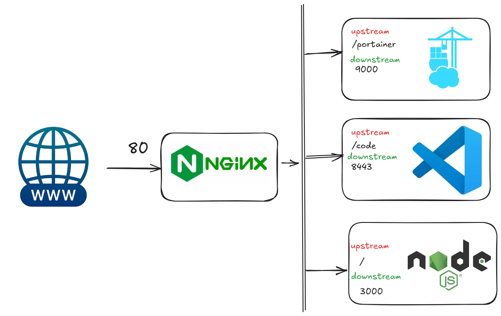

# 🚀 Despliegue de Servicios con Reverse Proxy & Nginx

- [🚀 Despliegue de Servicios con Reverse Proxy \& Nginx](#-despliegue-de-servicios-con-reverse-proxy--nginx)
  - [🎯 Vuestra Misión](#-vuestra-misión)
  - [🏗️ Arquitectura del Proyecto](#️-arquitectura-del-proyecto)
    - [¿Cómo funciona la "Magia" del Reverse Proxy?](#cómo-funciona-la-magia-del-reverse-proxy)
  - [🛠️ Guía Paso a Paso: Cómo añadir tus servicios](#️-guía-paso-a-paso-cómo-añadir-tus-servicios)
    - [1. Despliegue del Contenedor (`docker-compose.yml`)](#1-despliegue-del-contenedor-docker-composeyml)
    - [2. Configuración del Upstream (`nginx.conf`)](#2-configuración-del-upstream-nginxconf)
    - [3. Definición de la Ruta (`nginx.conf`)](#3-definición-de-la-ruta-nginxconf)
    - [4. Actualización del Dashboard (`apps.json`)](#4-actualización-del-dashboard-appsjson)
    - [5. 🔄 Aplicar cambios](#5--aplicar-cambios)
  - [📤 Entrega del Proyecto](#-entrega-del-proyecto)

¡Bienvenidos al laboratorio de despliegue! Este repositorio contiene un entorno de desarrollo completo basado en **Docker**. Ya tenéis configurado un ecosistema funcional con un Reverse Proxy (Nginx), una aplicación dashboard en Node.js, Portainer para gestión visual y un VS Code en el navegador.

## 🎯 Vuestra Misión

El objetivo de esta práctica es que toméis el control de este entorno y lo expandáis. Para completar el reto, debéis:

1. **Elegir y añadir 3 nuevos servicios** de vuestra elección al ecosistema Docker (pueden ser bases de datos, servidores web, herramientas como Adminer, un juego en HTML5, etc.).
2. **Configurar el Reverse Proxy** para que estos servicios sean accesibles desde el navegador.
3. **Integrarlos en el Dashboard**: Deben aparecer los botones de acceso en la página principal de la aplicación Node.js.
4. **📤 Entrega final**: Una vez que todo funcione, debéis subir el código final a vuestro repositorio de **GitHub**.

---

## 🏗️ Arquitectura del Proyecto

El entorno actual se compone de las siguientes piezas:

* **`nginx-proxy`**: El cerebro de la operación. Un servidor Nginx que recibe todo el tráfico y lo reparte.
* **`my-node-app`**: El Dashboard principal. Aquí veréis los enlaces a vuestros servicios.
* **`code`**: Vuestro IDE en la nube (VS Code) ejecutándose directamente en el navegador.
* **`portainer`**: Una interfaz gráfica para ver el estado de vuestros contenedores.


### ¿Cómo funciona la "Magia" del Reverse Proxy?

El Reverse Proxy actúa como un recepcionista. Se sitúa entre el usuario y vuestros servicios internos. Cuando llega una petición, Nginx mira la configuración y decide a qué contenedor debe enviarla.

En el archivo `nginx.conf` encontraréis dos conceptos clave:

1. **Upstreams**: Definen **quién** puede recibir las peticiones (el grupo de servidores).
```nginx
upstream app_upstream {
  server my-node-app:3000; # Nombre del contenedor y puerto interno
  keepalive 32;
}

```


2. **Locations**: Definen **cuándo** se redirige el tráfico (la regla de ruta).
```nginx
location / {
  proxy_pass http://app_upstream; # ¡Pasa, al fondo a la derecha!
}

```


---

## 🛠️ Guía Paso a Paso: Cómo añadir tus servicios

Para completar vuestra misión, seguid este flujo de trabajo para cada nuevo servicio:

### 1. Despliegue del Contenedor (`docker-compose.yml`)

Abrid el archivo `docker-compose.yml` y definid vuestro nuevo servicio.

> **Importante:** Aseguraos de asignar un `container_name` claro y verificar qué puerto interno utiliza esa imagen.

### 2. Configuración del Upstream (`nginx.conf`)

En el archivo `nginx.conf`, cread un bloque `upstream` nuevo.

* El nombre del servidor dentro del bloque debe coincidir exactamente con el `container_name` que pusisteis en el paso 1.

### 3. Definición de la Ruta (`nginx.conf`)

Añadid un bloque `location` para vuestro servicio.

* Decidid la ruta (ej: `/mi-servicio/`).
* Usad `proxy_pass` apuntando a vuestro upstream.
* *Tip:* Si el servicio no espera un prefijo en la URL, recordad usar `rewrite` para limpiarla (como en el ejemplo de Portainer).

### 4. Actualización del Dashboard (`apps.json`)

Para que aparezca el botón en la web principal, editad `app/config/apps.json`:

```json
{
  "name": "Mi Nuevo Servicio",
  "path": "/ruta/del/servicio/",
  "img": "/static/apps/generic.svg"
}

```

* `path`: Debe coincidir con la `location` que configurasteis en Nginx.

### 5. 🔄 Aplicar cambios

Una vez editados los archivos, reiniciad el entorno para que Docker y Nginx carguen la nueva configuración:

```bash
docker-compose down && docker-compose up -d

```

---

## 📤 Entrega del Proyecto

Una vez que hayáis verificado que los 3 servicios nuevos funcionan y son accesibles desde el dashboard:

1. Haced un **commit** con todos vuestros cambios.
2. Haced un **push** a vuestro repositorio de GitHub.
3. Verificad en GitHub que el código se ha actualizado correctamente.

¡Mucha suerte, devops en potencia! 🚀

