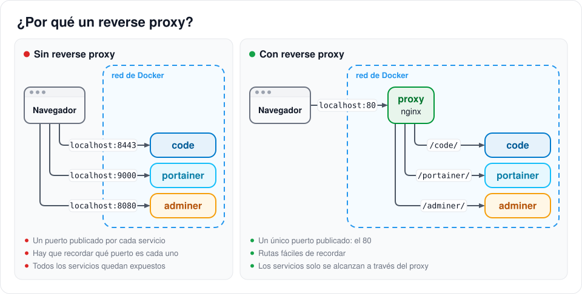
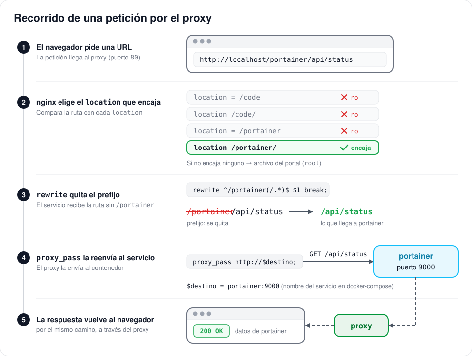
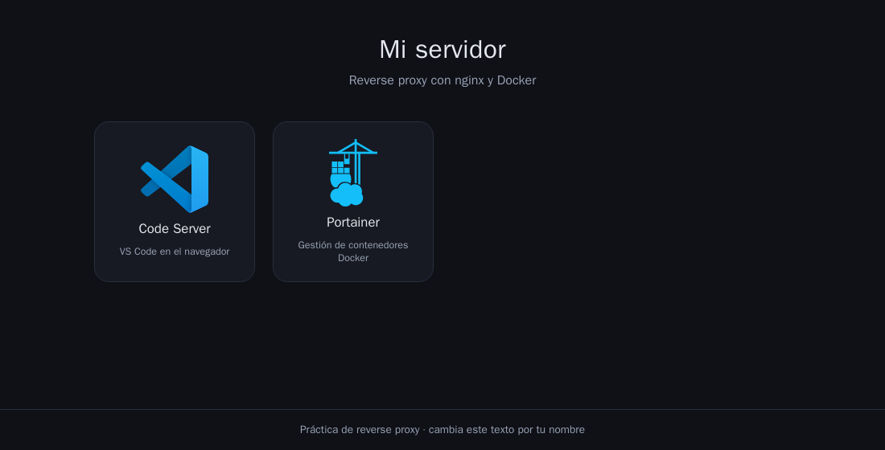
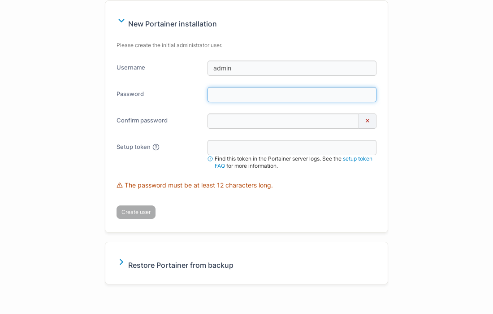
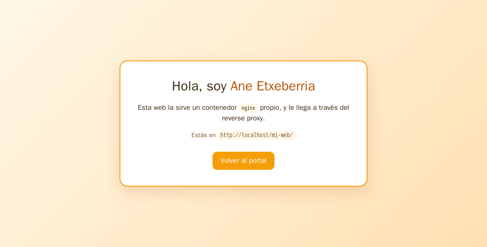
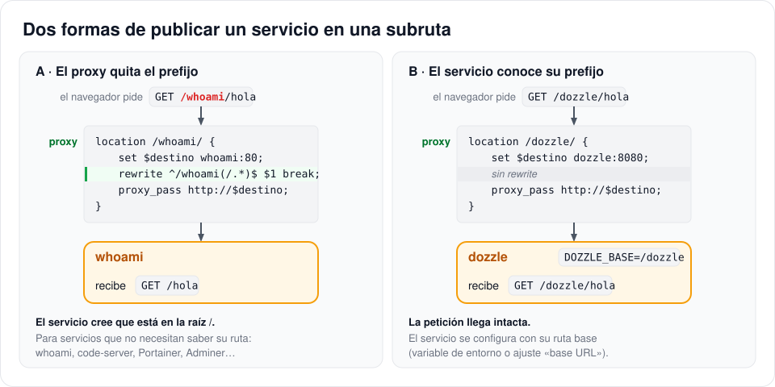
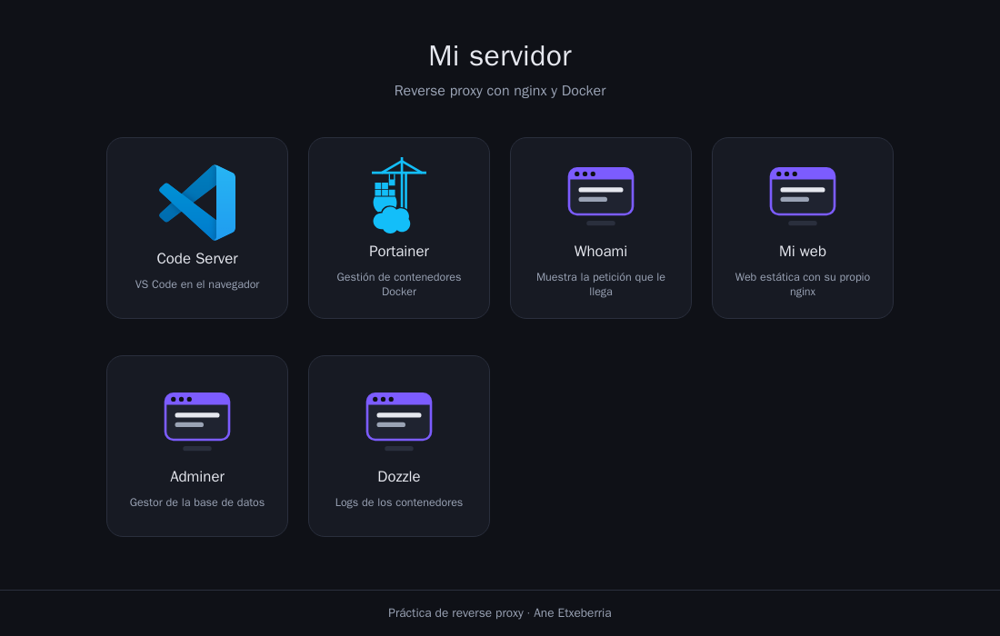

# 🔀 Práctica: reverse proxy con nginx y Docker

En esta práctica vas a montar un **reverse proxy**: un único nginx que recibe todas las peticiones en el puerto 80 y las reparte entre varios servicios según la ruta (`/code/`, `/portainer/`, `/whoami/`…). Es lo que hay delante de casi cualquier servidor real.

Partes de un entorno que ya funciona (el proxy, un portal de inicio, code-server y Portainer) y lo vas ampliando con nuevos servicios, tarea a tarea.

**Índice**

- [🎯 Qué vas a hacer](#-qué-vas-a-hacer)
- [🧠 Conceptos](#-conceptos)
  - [¿Qué es un reverse proxy?](#qué-es-un-reverse-proxy)
  - [Arquitectura de la práctica](#arquitectura-de-la-práctica)
  - [El `docker-compose.yml`](#el-docker-composeyml)
  - [El `nginx.conf`](#el-nginxconf)
- [🛠️ Tareas](#️-tareas)
  - [Tarea 1 · Arranca el entorno y explóralo](#tarea-1--arranca-el-entorno-y-explóralo)
  - [Tarea 2 · Tu primer servicio: whoami](#tarea-2--tu-primer-servicio-whoami)
  - [Tarea 3 · Publica una web estática](#tarea-3--publica-una-web-estática)
  - [Tarea 4 · Adminer y una base de datos](#tarea-4--adminer-y-una-base-de-datos)
  - [⭐ Reto · Un servicio que conoce su prefijo](#-reto--un-servicio-que-conoce-su-prefijo)
- [🔄 Cómo aplicar los cambios](#-cómo-aplicar-los-cambios)
- [🩺 Problemas frecuentes](#-problemas-frecuentes)
- [📤 Entrega](#-entrega)

---

## 🎯 Qué vas a hacer

| Tarea | Qué haces | Qué aprendes |
|---|---|---|
| 1 | Arrancas el entorno y personalizas el portal | Cómo está montado: un solo puerto, volúmenes, logs |
| 2 | Publicas **whoami** en `/whoami/` (guiada) | `location`, `rewrite`, `proxy_pass` y cabeceras |
| 3 | Publicas una **web estática** en `/mi-web/` y arreglas un fallo | Rutas absolutas y relativas detrás de un prefijo |
| 4 | Publicas **Adminer** en `/adminer/` con una base de datos detrás | Qué servicios se publican y cuáles se quedan dentro |
| ⭐ | (Opcional) Publicas **Dozzle** en `/dozzle/` | Servicios que necesitan conocer su ruta |

Necesitas **Docker Desktop** (o Docker Engine con `docker compose`) y **Git**.

---

## 🧠 Conceptos

### ¿Qué es un reverse proxy?

Es un servidor que se pone **delante** de tus servicios y hace de recepcionista: todas las visitas entran por la misma puerta (el puerto 80) y él decide, mirando la URL, a qué servicio pasar cada petición.



Ventajas:

- **Un solo puerto abierto.** Los servicios no se publican; solo se puede llegar a ellos a través del proxy.
- **URLs fáciles de recordar:** `http://localhost/portainer/` en vez de `http://localhost:9000`.
- **Un único punto de control** para añadir HTTPS, contraseñas, límites, logs…

### Arquitectura de la práctica


```text
nginx-reverse-proxy/
├── docker-compose.yml     ← los servicios (contenedores)
├── .env.template          ← plantilla de contraseñas (cópiala como .env)
├── proxy/
│   ├── nginx.conf         ← las reglas del reverse proxy
│   └── web/               ← el portal de inicio (http://localhost/)
│       ├── index.html
│       ├── apps.js        ← las cajas del portal: una por servicio
│       ├── estilo.css
│       └── img/           ← iconos (generica.svg sirve para cualquier servicio)
└── servicios/
    └── mi-web/            ← la web de la Tarea 3
```

### El `docker-compose.yml`

El proxy es un `nginx:alpine` **sin Dockerfile**: la configuración y la web se le pasan como **volúmenes**.

```yaml
services:
  proxy:
    image: nginx:alpine
    restart: unless-stopped
    ports:
      - "80:80"                 # el ÚNICO puerto publicado de todo el proyecto
    volumes:
      - ./proxy/nginx.conf:/etc/nginx/conf.d/default.conf:ro   # la configuración
      - ./proxy/web:/usr/share/nginx/html:ro                   # la web del portal

  portainer:                    # sin "ports": solo se llega a través del proxy
    image: portainer/portainer-ce:latest
    ...
```

Fíjate en dos cosas:

1. **Solo el proxy tiene `ports`.** El resto de servicios están en la red interna de Docker y no se puede entrar en ellos directamente desde el navegador.
2. **El nombre del servicio es su nombre en la red.** Dentro de Docker, el proxy llega a Portainer con `portainer:9000` y a code-server con `code:8443`: Docker hace de DNS.

Un volumen hace que el contenedor use **tus archivos**, no una copia: si cambias algo de `proxy/web/`, basta con recargar el navegador.


### El `nginx.conf`

Cada servicio publicado ocupa un bloque como este (el de Portainer):

```nginx
# --- PORTAINER: /portainer/ → servicio "portainer", puerto 9000 ---
location = /portainer { return 301 /portainer/; }
location /portainer/ {
    set $prefijo /portainer;
    set $destino portainer:9000;
    rewrite ^/portainer(/.*)$ $1 break;
    proxy_pass http://$destino;
}
```

| Línea | Qué hace |
|---|---|
| `location = /portainer { return 301 /portainer/; }` | Si alguien escribe `/portainer` sin la barra final, lo redirige a `/portainer/` |
| `location /portainer/ {` | Este bloque atiende **todas** las rutas que empiezan por `/portainer/` |
| `set $prefijo /portainer;` | Se envía al servicio en la cabecera `X-Forwarded-Prefix`, por si quiere saber bajo qué ruta está publicado |
| `set $destino portainer:9000;` | **Nombre del servicio** en el `docker-compose.yml` **:** **puerto interno** en el que escucha |
| `rewrite ^/portainer(/.*)$ $1 break;` | **Quita el prefijo:** `/portainer/api/status` pasa a ser `/api/status` |
| `proxy_pass http://$destino;` | Reenvía la petición al servicio y devuelve su respuesta al navegador |

Así viaja una petición:



Pruébalo tú mismo: abre <http://localhost/portainer/api/status> y verás la respuesta JSON de Portainer, que ha recibido la petición como `/api/status`.

| Pides… | Encaja con… | Resultado |
|---|---|---|
| `/portainer` | `location = /portainer` | Redirección a `/portainer/` |
| `/portainer/api/status` | `location /portainer/` | Portainer recibe `GET /api/status` |
| `/code/` | `location /code/` | code-server recibe `GET /` |
| `/apps.js` | ninguno | nginx sirve el archivo `proxy/web/apps.js` |
| `/noexiste` | ninguno | `404 Not Found` |

Al principio del fichero hay tres cosas que no hace falta tocar, pero conviene entender:

- **Las cabeceras `proxy_set_header`** (`Host`, `X-Real-IP`, `X-Forwarded-For`…) le cuentan al servicio quién hizo la petición original. Sin ellas, el servicio solo vería que le llama el proxy. Las verás en directo en la Tarea 2.
- **El bloque `map … $connection_upgrade`** deja pasar los **WebSockets**, conexiones que se quedan abiertas. code-server no funciona sin ellos.
- **`resolver 127.0.0.11`** junto con `set $destino` hacen que nginx busque cada servicio **en cada petición**, en vez de una sola vez al arrancar. Por eso el proxy arranca aunque un servicio esté parado o mal escrito: solo falla esa ruta, con un `502`.

---

## 🛠️ Tareas

### Tarea 1 · Arranca el entorno y explóralo

**1. Clona tu repositorio y crea el `.env`** con la contraseña de code-server:

```bash
git clone <url-de-tu-repositorio>
cd nginx-reverse-proxy
cp .env.template .env        # después edita .env y cambia la contraseña
```

**2. Arranca todo** y comprueba el estado:

```bash
docker compose up -d
docker compose ps
```

```text
SERVICE     STATUS         PORTS
code        Up 5 seconds   8443/tcp
portainer   Up 5 seconds   8000/tcp, 9000/tcp, 9443/tcp
proxy       Up 5 seconds   0.0.0.0:80->80/tcp
```

Solo `proxy` tiene un puerto publicado (`0.0.0.0:80->80`). Los demás muestran sus puertos internos, que no son accesibles desde fuera.

**3. Abre <http://localhost/>.** Es el portal, servido por el propio proxy desde `proxy/web/`:



**4. Entra en Code Server** (`/code/`) con la contraseña del `.env`. Es VS Code en el navegador, abierto sobre la carpeta del proyecto: puedes editar los ficheros de la práctica desde aquí. Si te pregunta si confías en la carpeta, pulsa **Trust**.


**5. Entra en Portainer** (`/portainer/`) y crea el usuario administrador:

- La contraseña debe tener **al menos 12 caracteres**.
- Te pide un **setup token**, que Portainer escribe en sus logs al arrancar:

  ```bash
  docker compose logs portainer | grep setup_token              # Git Bash, Linux, macOS
  docker compose logs portainer | Select-String setup_token     # PowerShell
  ```

  ```text
  portainer-1  | setup_token=64752a9c...
  ```



> ⏱️ Tienes **5 minutos** desde que arranca Portainer para crear el usuario. Si se pasa el tiempo, al entrar en `/portainer/` acabarás en un `404` en `/timeout.html`. Ejecuta `docker compose restart portainer` y vuelve a intentarlo (el token cambia en cada arranque).

**6. Personaliza el portal.** Edita `proxy/web/apps.js` y cambia el título y el pie (pon tu nombre):

```js
const PORTAL = {
  titulo: 'Servidor de Ane',
  subtitulo: 'Reverse proxy con nginx y Docker',
  pie: 'Práctica de reverse proxy · Ane Etxeberria',
};
```

Guarda y recarga el navegador (F5). No hace falta reiniciar nada: `proxy/web/` es un volumen.

✅ **Comprueba:** el portal muestra tu nombre, entras en code-server y en Portainer, y <http://localhost:9000> **no** responde. Portainer solo es accesible a través del proxy.

---

### Tarea 2 · Tu primer servicio: whoami

[whoami](https://github.com/traefik/whoami) es un servidor web diminuto que responde con **la petición que le ha llegado**. Es perfecto para ver qué hace el proxy con cada petición.

**1. Añade el servicio** al final de `services:` en `docker-compose.yml`, sin `ports`:

```yaml
  whoami:                       # → /whoami/
    image: traefik/whoami
    restart: unless-stopped
```

```bash
docker compose up -d
```

**2. Añade su bloque** en `proxy/nginx.conf`, dentro de `server { … }`, después del de Portainer. whoami escucha en el puerto **80**:

```nginx
    # --- WHOAMI: /whoami/ → servicio "whoami", puerto 80 ---
    location = /whoami { return 301 /whoami/; }
    location /whoami/ {
        set $prefijo /whoami;
        set $destino whoami:80;
        rewrite ^/whoami(/.*)$ $1 break;
        proxy_pass http://$destino;
    }
```

**3. Reinicia el proxy** para que lea la nueva configuración, y mira sus logs por si hay errores:

```bash
docker compose restart proxy
docker compose logs proxy
```

**4. Prueba** <http://localhost/whoami/hola>:

```text
Hostname: 5d30021cbe95
IP: 127.0.0.1
IP: 172.22.0.5
RemoteAddr: 172.22.0.4:49914          ← quién le habla: el PROXY
GET /hola HTTP/1.1                    ← la ruta que le llega: SIN /whoami
Host: localhost
User-Agent: Mozilla/5.0 (...)
X-Forwarded-For: 172.22.0.1           ← quién hizo la petición original: TU navegador
X-Forwarded-Prefix: /whoami           ← bajo qué ruta está publicado
X-Forwarded-Proto: http
X-Real-Ip: 172.22.0.1
```

**5. Añádelo al portal** en `proxy/web/apps.js`, dentro de `APPS`:

```js
  {
    nombre: 'Whoami',
    ruta: '/whoami/',                  // la misma ruta que su location
    imagen: 'img/generica.svg',        // o descarga un icono en img/
    descripcion: 'Muestra la petición que le llega',
  },
```

🧪 **Experimento 1: sin `rewrite`.** Comenta la línea del `rewrite` poniendo `#` delante, reinicia el proxy y vuelve a abrir `/whoami/hola`. Ahora whoami recibe `GET /whoami/hola`: el prefijo llega entero. Vuelve a dejar la línea como estaba.

🧪 **Experimento 2: servicio caído.** Para whoami y entra en `/whoami/`:

```bash
docker compose stop whoami
docker compose logs proxy --tail 3
```

Verás `502 Bad Gateway` en el navegador y `whoami could not be resolved` en el log. El portal y el resto de rutas siguen funcionando. Arráncalo de nuevo con `docker compose start whoami`.

---

### Tarea 3 · Publica una web estática

En `servicios/mi-web/` tienes una web sencilla. La va a servir **su propio contenedor nginx**, y el proxy la publicará en `/mi-web/`.

**1. Añade el servicio.** Es la misma idea que el proxy: un `nginx:alpine` con la web montada como volumen.

```yaml
  mi-web:                       # → /mi-web/
    image: nginx:alpine
    restart: unless-stopped
    volumes:
      - ./servicios/mi-web:/usr/share/nginx/html:ro
```

**2. Escribe tú el bloque** en `nginx.conf`, siguiendo el de whoami. Datos: ruta `/mi-web/`, servicio `mi-web`, puerto `80`. Reinicia el proxy.

**3. Abre <http://localhost/mi-web/>.** Algo falla: la página sale **sin estilos**.

<p align="center">
  
  
</p>

**4. Investiga.** Pulsa **F12 → Red (Network)** y recarga. Verás que `web.css` da **404** y que el navegador lo ha pedido a `http://localhost/css/web.css`, fuera de `/mi-web/`. Mira el `<link>` de `servicios/mi-web/index.html`:

```html
<link rel="stylesheet" href="/css/web.css">
```

La ruta empieza por `/`, así que es **absoluta**: el navegador la busca en la raíz del servidor, que es el portal, no tu web.


**5. Arréglalo** quitando la `/` inicial (`href="css/web.css"`) y recarga con F5. Como la web es un volumen, el cambio se ve al momento. Pon también tu nombre en el `<h1>`.

> El enlace **Volver al portal** (`href="/"`) sí es absoluto a propósito: queremos salir de `/mi-web/` e ir a la raíz.

**6. Añádela al portal** en `apps.js`.

---

### Tarea 4 · Adminer y una base de datos

[Adminer](https://www.adminer.org/) es un gestor de bases de datos web. Vas a publicarlo en `/adminer/` con una base de datos MariaDB detrás. **La base de datos no se publica:** solo Adminer habla con ella, dentro de la red de Docker.

**1. Añade la contraseña de la base de datos** al `.env` (y también a `.env.template`, para que quien clone tu repositorio sepa que hace falta):

```bash
# Contraseña del usuario root de MariaDB
DB_PASSWORD=cambiame
```

**2. Añade los dos servicios:**

```yaml
  db:                           # base de datos: NO pasa por el proxy
    image: mariadb:11
    restart: unless-stopped
    environment:
      MARIADB_ROOT_PASSWORD: "${DB_PASSWORD:?Falta DB_PASSWORD en .env}"
      MARIADB_DATABASE: clase
    volumes:
      - db_datos:/var/lib/mysql

  adminer:                      # → /adminer/
    image: adminer
    restart: unless-stopped
    environment:
      ADMINER_DEFAULT_SERVER: db
```

Y declara el volumen al final del fichero, en la sección `volumes:`:

```yaml
volumes:
  code_config:
  portainer_data:
  db_datos:
```

**3. Escribe el bloque** de `/adminer/` en `nginx.conf`. Adminer escucha en el puerto **8080**. Arranca con `docker compose up -d` y reinicia el proxy.

**4. Entra en <http://localhost/adminer/>** con servidor `db`, usuario `root`, la contraseña del `.env` y base de datos `clase`. Fíjate en que el servidor es `db`: otra vez, el nombre del servicio.


**5. Añádelo al portal.**

---

### ⭐ Reto · Un servicio que conoce su prefijo

Hasta ahora el proxy **quitaba el prefijo** con `rewrite` y el servicio creía estar en `/`. Algunos servicios funcionan mejor (o solo funcionan) si **saben** en qué ruta están publicados. En ese caso se les configura su ruta base y el proxy pasa la petición **sin rewrite**.



Publica [Dozzle](https://dozzle.dev/), un visor de logs de contenedores, en `/dozzle/`. Pistas:

- Imagen `amir20/dozzle:latest`, puerto **8080**.
- Necesita leer el socket de Docker: `/var/run/docker.sock:/var/run/docker.sock:ro`.
- Su ruta base se configura con la variable de entorno `DOZZLE_BASE=/dozzle`.
- Su bloque en `nginx.conf` **no** lleva `rewrite`.
- La primera vez muestra un asistente de configuración: pulsa **Continuar sin inicio de sesión**.

Si prefieres otro servicio, busca en su documentación *base path*, *subpath* o *reverse proxy*. Ten en cuenta que algunas aplicaciones no funcionan en una subruta (por ejemplo, Uptime Kuma) y necesitarían un subdominio propio.

---

## 🔄 Cómo aplicar los cambios

| Has cambiado… | Haz… |
|---|---|
| Algo en `proxy/web/` o en `servicios/mi-web/` | Recarga el navegador (F5) |
| `proxy/nginx.conf` | `docker compose restart proxy` |
| `docker-compose.yml` o `.env` | `docker compose up -d` |

> También puedes reiniciar el proxy desde Portainer: **Containers → proxy → Restart**.

---

## 🩺 Problemas frecuentes

Lo primero, siempre: `docker compose ps` y `docker compose logs proxy`.

| Síntoma | Causa probable | Solución |
|---|---|---|
| **`502 Bad Gateway`** y en el log `could not be resolved` | El servicio está parado o el nombre en `$destino` no coincide con el del `docker-compose.yml` | `docker compose ps`; revisa el nombre |
| **`502 Bad Gateway`** y en el log `connect() failed (111: Connection refused)` | El puerto de `$destino` no es el puerto en el que escucha el servicio | Mira en la documentación de la imagen su puerto interno |
| **`404 Not Found`** de nginx | La ruta no encaja con ningún `location`, así que nginx la busca como archivo del portal | Revisa la ruta del `location` y la barra final |
| La página sale **sin estilos o sin imágenes** | Rutas absolutas (`/css/…`) detrás de un prefijo | Usa rutas relativas ([Tarea 3](#tarea-3--publica-una-web-estática)) |
| No carga **nada** (ni el portal) y el proxy aparece como `Restarting` | Error de sintaxis en `nginx.conf` | `docker compose logs proxy` muestra la línea: `[emerg] unexpected "}" in /etc/nginx/conf.d/default.conf:57` |
| `/portainer/` da `404` en `/timeout.html` | Pasaron 5 minutos sin crear el usuario admin | `docker compose restart portainer` y créalo enseguida |
| `Falta CODE_PASSWORD` al usar `docker compose` | No existe el fichero `.env` | `cp .env.template .env` |
| `bind: address already in use` al arrancar | Otro programa usa el puerto 80 | Cambia `"80:80"` por `"8080:80"` y entra en `http://localhost:8080/` |
| He cambiado `nginx.conf` y no pasa nada | El proxy no se ha reiniciado | `docker compose restart proxy` |

---

## 📤 Entrega

Así debería quedar tu portal (aquí con el reto incluido):



**Lista de comprobación:**

- [ ] El portal muestra tu nombre.
- [ ] `/whoami/`, `/mi-web/` y `/adminer/` funcionan y tienen su caja en el portal.
- [ ] `/mi-web/` se ve con estilos y con tu nombre.
- [ ] Adminer conecta con la base de datos `db`.
- [ ] `.env.template` incluye `DB_PASSWORD` y el `.env` **no** está en el repositorio.
- [ ] Has creado `RESPUESTAS.md` con las respuestas a estas preguntas (2-3 líneas cada una):
  1. ¿Por qué solo el servicio `proxy` tiene `ports`? ¿Qué se gana con ello?
  2. ¿Qué ruta recibe whoami con `rewrite` y sin él? ¿Para qué sirve el `rewrite`?
  3. ¿Por qué tu web salía sin estilos y cómo lo arreglaste?
  4. ¿Por qué la base de datos no tiene un `location` en el proxy?
  5. ¿Qué pasa al entrar en la ruta de un servicio parado? ¿Y en las demás rutas? ¿Por qué?

Sube tus cambios:

```bash
git add .
git commit -m "Práctica reverse proxy"
git push
```

Comprueba en GitHub que están todos los ficheros y que **no** aparece `.env`.

¡Suerte! 🚀
